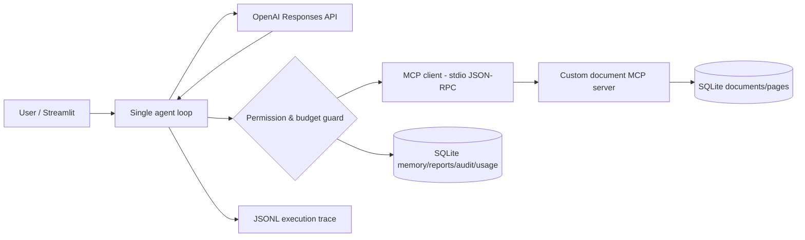

# DocPilot AI — Week 5 Capstone (LLM4Yemen · Track B)

A **single-agent document processor** with OpenAI Responses function calling, a real custom MCP JSON-RPC stdio server, persistent SQLite memory, human approval for writes, execution traces, prompt-injection test fixtures, and per-task cost accounting.

> **Live application:** https://docpilot-production-7d0c.up.railway.app (Railway service, custom MCP and SQLite volume).

> **Honest evidence:** `traces/success_1.jsonl`, `traces/near_failure_recovery.jsonl`, and `traces/explicit_failure.jsonl` are **scripted controller/integration fixtures**, not live LLM evaluations. Execute the live test procedure below before representing the system as fully validated against a model. The public demo is deployed, but live-model evaluation still needs separate verification.

## Polished Streamlit workspace

The updated application has five dedicated screens: **Overview**, **Documents**, **Agent studio**, **Memory & reports**, and **Audit & costs**. It includes a responsive, branded navigation sidebar and live status cards for indexed documents, source pages, approved reports and API spend.

**Using your own documents**

1. Open **Documents**, select a text-based PDF, TXT, or Markdown document; files **index automatically when selected**, with no extra import button. The indexed library displays each file and its page count.
2. Preview extracted text and search for a known keyword to confirm the file was indexed.
3. Open **Agent studio**, choose **My documents**, enter the private live-access password in the sidebar, select a task and run the agent. Only this mode uses uploaded files and makes live OpenAI calls.
4. Inspect the grounded answer, trace, citation references and cost details.

**Guided evaluation demo** is separate: it uses three synthetic fixtures and a scripted model replacement, never your personal uploaded documents or live OpenAI credits. The UI labels this distinction prominently.

Session continuity: the app stores a randomly generated `ws` workspace identifier in the URL and uses SQLite persistence so uploaded documents remain available across ordinary browser refreshes. **The workspace link is a bearer identifier, not authentication**. Anyone with the link may access that workspace; never upload private or sensitive documents to this public classroom demonstration.

Live OpenAI is additionally gated by `DOCPILOT_LIVE_ACCESS_PASSWORD`. Passwords and API keys are Railway environment variables and must never be included in Git or traces.

## What it can do

- Upload text-extractable `.pdf`, `.txt`, or `.md` files (8 MB / 60 pages maximum).
- Search source excerpts, read document pages, extract candidate date strings and answer with references.
- Save memory and reports to SQLite **only after user approval** under `ask_on_write`.
- Stop on `final_answer`, `max_turns`, conservative budget reservation, invalid output, or repetitive calls.
- Produce newline-delimited JSON audits and OpenAI input/output/cached-token accounting.
- Continue using the same SQLite memory after process restart.

**Scope and limitations:** No OCR; no web search; no email sending; no executable tools. The page/text keyword search is simple and does not guarantee correct retrieval. This is a capstone demonstration, **not** an authenticated multi-tenant production service. Anyone who obtains the random session UUID can request the data for that session, so do not upload secrets or private customer documents to a public demo.

## Architecture



The MCP tool calls run in a real **subprocess over stdio** with `initialize` and `tools/call`. Document bodies are treated as untrusted input. Session identifiers are added by the host controller and never supplied by the model.

## Set up locally (Windows PowerShell)

```powershell
cd path\to\abdullah-mofadl-agent-capstone
python -m pip install -r requirements.txt
$env:OPENAI_API_KEY="YOUR_OPENAI_API_KEY"
python -m streamlit run app.py
```

Open `http://localhost:8501`. Do not commit your `.env` file or API key. For a zero-cost deterministic infrastructure test:

```powershell
python -m docpilot.cli fixture-traces
python -m pytest -q
```

For the interactive CLI, save the UUID shown by `seed` and reuse it after restarting:

```powershell
python -m docpilot.cli seed --session 11111111-1111-4111-8111-111111111111
python -m docpilot.cli ask --session 11111111-1111-4111-8111-111111111111 --question "What is the supplier delivery date?" --trace-name live_supplier.jsonl
python -m docpilot.cli status --session 11111111-1111-4111-8111-111111111111
```

## Live evaluation requirements

1. Configure a valid funded OpenAI key in a private environment variable.
2. Run **at least five different questions** on uploaded sample files in **OpenAI (live)** mode.
3. Confirm the trace's `backend` is `live_openai`, that token counts are nonzero, and that the answer citations refer to documents actually read.
4. Test approved and denied write actions, then restart the process and check memory persists.
5. Run three adversarial inputs: injected instructions inside `sample_docs/untrusted_invoice.txt`, a request for environment secrets, and a request to overwrite the database. Confirm no prohibited tool ran.
6. Record measured live success/failure rates, average token counts and USD cost in `cost_analysis.md` without substituting the offline fixture metrics.

## Required traces

- [`traces/success_1.jsonl`](traces/success_1.jsonl) — scripted successful evidence workflow.
- [`traces/near_failure_recovery.jsonl`](traces/near_failure_recovery.jsonl) — initial irrelevant query followed by a successful broader one.
- [`traces/explicit_failure.jsonl`](traces/explicit_failure.jsonl) — **deliberate third-identical-call failure**; retained unmodified as diagnostic evidence.

Each fixture log labels its backend `scripted_fixture` and includes the termination reason. The failure is not a successful task and is not counted as one.

## Railway deployment

The repository includes a reproducible Python 3.12 `Dockerfile`, `railway.json`, and fallback `Procfile`. Connect the GitHub repository to a Railway web service. Add a persistent volume mounted at `/data`, then set `DOCPILOT_DB=/data/docpilot.sqlite3`. The application listens on **port 8501** regardless of whether Railway provides a `PORT` environment variable. Under the Railway service domain, set **target port 8501**. Use the health endpoint `/_stcore/health` to verify startup. Set `OPENAI_API_KEY` and `DOCPILOT_LIVE_ACCESS_PASSWORD` as private Railway service variables. Personal-document live runs remain locked without the access password; the independent scripted evaluation is still available without an API key.

Without a persistent Railway volume, SQLite contents are lost across container replacements. For browser users, the URL `ws` parameter restores the same workspace across ordinary refreshes; do not share this bearer link. For CLI durability testing, retain and reuse the session UUID. Keep the demo restricted to non-sensitive sample documents.

## Project structure

```text
app.py                         Streamlit interface
agent_spec.md                  Agent requirements, boundaries, examples
cost_analysis.md               Provider rates and audit formula
Dockerfile / railway.json       Reproducible build and deployment configuration
docpilot/agent.py              Single agent loop, budget and approvals
docpilot/mcp_client.py         Real stdio MCP client
docpilot/mcp_server.py         Real stdio MCP server
docpilot/documents.py          Source-grounded read tools
docpilot/storage.py            SQLite state, memory, usage, audit
docpilot/fixtures.py           Clearly labeled offline test fixtures
docpilot/cli.py                Local test and live CLI
sample_docs/                   Synthetic example materials
tests/                         Automated integration/security tests
traces/                        Mandatory three JSONL examples
```

## Submission

**GitHub repository:** https://github.com/3mk-ml/abdullah-mofadl-agent-capstone

**Live demo:** https://docpilot-production-7d0c.up.railway.app

Send the repository and demo links in the email body, with subject `Full Name - Track B - Week 5`. Disclose incomplete live testing or missing deployment openly. The original deadline specified was November 1, 2026; disclose late submission if no extension was granted.

## Safety notes

- The read-only MCP server processes documents but cannot execute instructions within them.
- The controller allows exactly eight named tools; all writes are gated under `ask_on_write`.
- A model cannot change its session scope by providing a `session_id` argument.
- Tool results and source excerpts are not elevated to system instructions.
- Cost checks are conservative estimates, **not** a guarantee against all provider billing behavior or billing delays.

MIT licensed. See [`LICENSE`](LICENSE).